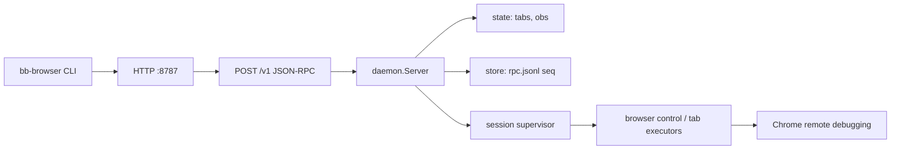

# go-bb-browser

用 **Go** 实现的 [bb-browser](https://github.com/epiral/bb-browser) 风格工具链：**CLI（`bb-browser`）→ 本地 HTTP 守护进程（`bb-daemon`）→ 仅通过 CDP 控制已启动的 Google Chrome**。守护进程**不会启动浏览器**，只通过 **chromedp** 附加到你用 `--remote-debugging-port`（等）拉起的 Chrome；**无扩展、不支持其他浏览器**。

面向 Agent 的约定见 [`AGENTS.md`](AGENTS.md)。

## 构建与测试

```bash
go build -o bb-daemon ./cmd/bb-daemon
go build -o bb-browser  ./cmd/bb-browser
go test ./...
```

## 快速开始

1. 启动带远程调试的 Chrome（可用 CLI 辅助）：

   ```bash
   ./bb-browser launch
   # 标准输出为 host:port，例如 127.0.0.1:9222 → 供 bb-daemon --debugger-url 使用
   ```

2. 启动守护进程（附加到上一步的调试端口）：

   ```bash
   export BB_BROWSER_DEBUGGER_URL=127.0.0.1:9222   # 或每次传 --debugger-url
   ./bb-daemon
   # 默认监听 127.0.0.1:8787；可用 --listen 或 BB_BROWSER_LISTEN
   ```

3. 用 `bb-browser` 调接口（默认 `--url http://127.0.0.1:8787`，可用 `BB_BROWSER_URL` 覆盖）。

---

## `bb-daemon` 架构

数据流：**客户端（CLI / 任意 HTTP） → `bb-daemon` HTTP → JSON-RPC 分发 → `internal/browser`（chromedp CDP 会话）→ Chrome**。

| 层级 | 职责 |
|------|------|
| **`cmd/bb-daemon`** | 解析 `--debugger-url` / `--listen`（及对应环境变量），构造 `daemon.Config`，启动 `daemon.Server`。 |
| **`internal/daemon`** | `http.ServeMux`、JSON-RPC 分发、tab 生命周期协调器和 CDP supervisor。supervisor 以 `Browser.getVersion` 维护 `ready → suspect → failed`；确认失败后 daemon 非零退出，由 systemd/Docker 重启，不在进程内重连。 |
| **`internal/store`** | **RPC log**（`{StateDir}/rpc.jsonl`，append-only）；**全局单调 `seq`**（启动时以纳秒时钟为起始值，内存自增）。 |
| **`internal/state`** | **短 tab id 注册表**（`TabRegistry`，关 tab 释放 id、清缓冲）；**按 tab 隔离的观测环形缓冲**（`TabObsStore` + `ringbuf`），满足 INV-1～INV-7 类不变量。 |
| **`internal/daemon`（观测）** | network / console / errors 首次查询时按需启用并续租；listener 只向每 tab 的 1024 容量非阻塞队列投递，worker 编码并写 ring buffer。 |
| **`internal/browser`** | browser control 只在 browser executor 上执行 `Browser.*` / `Target.*`；每 tab 独立缓存执行 context，observer context 与页面操作 context 分离；**不**负责启动 Chrome。 |
| **`pkg/protocol`** | JSON-RPC 请求/响应与各 `method` 的 params/result 类型，供 daemon 与 `pkg/daemonclient` 共用。 |



**环境变量（节选）**

| 变量 | 含义 |
|------|------|
| `BB_BROWSER_DEBUGGER_URL` | Chrome DevTools 端点（`host:port` 或 ws/http URL），等价 `--debugger-url` |
| `BB_BROWSER_LISTEN` | daemon 监听地址，默认 `127.0.0.1:8787` |
| `BB_BROWSER_API_TOKEN` | daemon API token 白名单，英文逗号分隔，与可重复的 `--api-token` 合并；CLI 使用同名变量或 `--api-token` 发送单个 token（标志覆盖环境变量） |
| `BB_BROWSER_API_TOKEN_ALLOW_LOOPBACK` | 等价 `--api-token-allow-loopback`，默认 `false`；仅真实 TCP 回环对端且无代理头的 `POST /v1` 免 token；布尔值支持 `true/false`、`1/0`、`t/f` 及其 `strconv.ParseBool` 大小写形式，非法或空值回退 `false`，标志覆盖环境变量 |
| `BB_BROWSER_API_TOKEN_FILE` | daemon token 文件路径，等价 `--api-token-file`；一行一个 token，忽略空行和 `#` 注释行 |
| `BB_BROWSER_TAB_IDLE_TIMEOUT` | 自动关闭 daemon 创建的 idle tab 的超时，默认 `5m`；`0` 禁用 |
| `BB_BROWSER_CDP_WATCHDOG_INTERVAL` | `Browser.getVersion` 探测间隔，默认 `5s` |
| `BB_BROWSER_CDP_WATCHDOG_TIMEOUT` | 单次探测超时，默认 `2s` |
| `BB_BROWSER_CDP_WATCHDOG_FAILURES` | 连续失败多少次后确认 session 失效并退出，默认 `3` |
| `BB_BROWSER_OBSERVER_IDLE_TIMEOUT` | 观测接口无查询后 disable CDP domain 的时间，默认 `5m`；`0` 表示保持到 tab 关闭 |
| `BB_BROWSER_STATE_DIR` | RPC log 目录，默认 `~/.local/state/bb-daemon`（`rpc.jsonl`）；`-` 为 in-memory；等价 `--state-dir` |
| `BB_BROWSER_RPC_LOG_MAX_BYTES` | `rpc.jsonl` 超过该字节数即轮转，默认 `8388608`（8 MiB）；等价 `--rpc-log-max-bytes` |
| `BB_BROWSER_LOG_LEVEL` | slog 级别：`debug` / `info` / `warn` / `error`，默认 `info`；等价 `--log-level` |
| `BB_BROWSER_LOG_FORMAT` | slog 输出格式：`text` 或 `json`，默认 `text`；等价 `--log-format` |

**可选 API token**：daemon 将重复的 `--api-token`、`BB_BROWSER_API_TOKEN`（英文逗号分隔）和 `--api-token-file` / `BB_BROWSER_API_TOKEN_FILE` 的内容合并，去首尾空白、去重、忽略空项；文件忽略空行和以 `#` 开头的注释行。文件路径的标志覆盖环境变量；文件读取失败会拒绝启动。合并后为空时保持原有行为；未启用且监听非回环地址时只打一条 warn，不拒绝启动。修改白名单需重启 daemon。

启用 token 后，除下述显式开启的回环豁免外，`POST /v1` 必须携带 `Authorization: Bearer <token>`（客户端每次只传白名单中的一个 token），否则返回标准 **HTTP 401**，`Content-Type: text/plain; charset=utf-8`，正文固定为 `unauthorized\n`，并带 `WWW-Authenticate: Bearer`。鉴权在读取请求体、RPC 分发和 audit 前完成，失败请求不会操作浏览器或写 `rpc.jsonl`。`/live`、`/ready`、`/health` 始终免 token。API token 不写入启动日志、错误信息或 RPC audit；用 token 文件可避免 token 出现在 daemon 进程参数中。

```bash
# 文件一行一个 token；此处和部署示例只使用占位符
bb-daemon --debugger-url 127.0.0.1:9222 --api-token-file /path/to/api-tokens
BB_BROWSER_API_TOKEN='<caller-token>' bb-browser tab list
```

**可选回环免 token**：`--api-token-allow-loopback` / `BB_BROWSER_API_TOKEN_ALLOW_LOOPBACK` 默认关闭，修改后需重启。开启且白名单非空时，仅根据 `r.RemoteAddr` 的真实 TCP 对端判断回环（`127.0.0.0/8`、`::1`，含 IPv4 映射 IPv6）；无代理头才直接放行，**不校验 Authorization，即使带错误 token 也放行**。绝不使用 `Host` 或转发头判断本机。未配置 token 时开关无副作用，启动打一条 info；有 token 时启动打一条 warn，不逐请求记录。

请求只要出现 `X-Forwarded-For`、`X-Forwarded-Host`、`X-Forwarded-Proto`、`X-Real-IP`、`Forwarded`、`CF-Connecting-IP`、`CF-Ray`、`True-Client-IP`、`Via`、`X-Forwarded-Server`、`X-Forwarded-Port`、`X-Forwarded-Scheme`、`X-Original-Forwarded-For`、`Forwarded-For`、`X-Client-IP`、`X-Cluster-Client-IP` 或任意 `Tailscale-` 前缀头（头名大小写不敏感，即使值为空），就仍需有效 token。**头检测只是兜底，不是主要防线**；开启前必须确认部署路径。

- 本机直接调用可以开；Tailscale **HTTP 转发**（`serve` / `funnel` 默认模式，代理头完整保留到 daemon）可以开，转发请求会触发兜底，仍需 token。[Serve 官方文档](https://tailscale.com/docs/features/tailscale-serve#identity-headers) 确认用户身份头，且说明 tagged 设备及 Funnel 不带身份头；[官方 HTTP 代理源码](https://github.com/tailscale/tailscale/blob/main/ipn/ipnlocal/serve.go) 还设置 `X-Forwarded-Host`、`X-Forwarded-For`，TLS 时设置 `X-Forwarded-Proto`，Funnel 时设置 `Tailscale-Funnel-Request`。后者未能从官方文档确认，此处依据源码，未实测。
- **不要开**：Tailscale **TCP 转发**（如 `tailscale serve --tcp` / `--tls-terminated-tcp`）、同机反向代理且可能去头、Docker 端口映射、cloudflared 隧道，或不确定中间有没有代理时。

```bash
# 仅限确认部署路径后开启；本机直接调用可以省略 token
bb-daemon --debugger-url 127.0.0.1:9222 --api-token-file /path/to/api-tokens --api-token-allow-loopback
bb-browser tab list
```

**短 tab id 契约**：短 id 是 CDP target id 的别名，由**当前存活的 tab 集合**唯一决定，与登记顺序、是否重启无关。

- 每个 tab 可用其 target id 十六进制位（小写）的任意 **≥4 位后缀**寻址；`tab_new` / `tab_list` / `tab_focus` 返回其中**最短且无歧义**的一个，没有其他 tab 共享末 4 位时就是 4 位。
- 一个别名只有在**恰好一个**存活 tab 拥有它时才能解析。两个 tab 末 4 位相同时，这个 4 位 id 对双方都是硬错误（`unknown tab id`，`hint` 说明是歧义），不会落到“先登记”的那个 tab 上；双方改用更长的 id（`tab_list` 可查）。碰撞一方关闭后，4 位 id 恢复可用，碰撞期间发出的更长 id 继续有效。
- 因此**已发出的 4 位 id 可能因为之后出现的碰撞而失效**（报错，而不是指向别的 tab）；调用方遇到歧义错误时应重新 `tab_list`。
- tab 关闭即释放其所有别名，之后的新 tab 可以合法地得到同一个短 id。需要跨 tab 生命周期或跨重启识别 tab 的地方（`rpc.jsonl`、idle 恢复）一律使用完整 target id。
- 极端情形（target id 的十六进制位不足 4 位，或两个 id 的十六进制位完全相同）下，无法区分的 tab 以 `id=<完整 target id>` 作为短 id。

**Idle tab 自动清理**：`tab_new` 创建的 tab 会被 daemon 跟踪；在 `BB_BROWSER_TAB_IDLE_TIMEOUT` 内无操作则自动 `tab_close`。清理时若 Chrome 中的目标已不存在，直接清除该 tab 的本地状态，不告警或重复重试；其他关闭失败仍告警并保留重试。tab 相关 JSON-RPC 的 **`method` + 原始 request body** 写入 `rpc.jsonl`；idle 状态维护在内存。**daemon 重启**时先通过 CDP 获取当前存在的 tab，再回放 `rpc.jsonl` 求出这些 tab 的最后活跃时间来恢复 idle 跟踪。每条日志除短 id（`tab`）外还记录处理请求时解析到的**完整 CDP target id**（`target`），恢复只按完整 target id 与当前存在的 tab 比对，不经过短 id；没有 `target` 字段的旧版日志记录不会恢复受管资格（升级后首次重启，升级前创建的 tab 不再被自动 idle 关闭）。重启后有约 30s grace。全局 `seq` 以启动时的纳秒时钟为起始值内存自增，无需持久化即可跨重启保持递增。`rpc.jsonl` 超过约 8 MiB 会自动轮转：旧文件保存为 `rpc.jsonl.1`…（保留 3 份），新文件开头会写入当前存活 managed tab 的快照（合成 `tab_new` + 完整 target id + 最后活跃时间），因此恢复只需读当前文件即可保持完整。

**Docker Compose 示例**（需挂载 volume 才能跨容器重建保留 state）：

```yaml
services:
  bb-daemon:
    image: your/bb-daemon:latest
    environment:
      BB_BROWSER_DEBUGGER_URL: "http://chrome:9222"
      BB_BROWSER_LISTEN: "0.0.0.0:8787"
      BB_BROWSER_API_TOKEN: "<caller-a-token>,<caller-b-token>"
      # Docker 端口映射下不要开启回环豁免
      BB_BROWSER_API_TOKEN_ALLOW_LOOPBACK: "false"
      BB_BROWSER_STATE_DIR: "/var/lib/bb-daemon"
      BB_BROWSER_TAB_IDLE_TIMEOUT: "5m"
      BB_BROWSER_OBSERVER_IDLE_TIMEOUT: "5m"
      BB_BROWSER_CDP_WATCHDOG_INTERVAL: "5s"
      BB_BROWSER_CDP_WATCHDOG_TIMEOUT: "2s"
      BB_BROWSER_CDP_WATCHDOG_FAILURES: "3"
    ports:
      - "8787:8787"
    volumes:
      - bb-state:/var/lib/bb-daemon

volumes:
  bb-state:
```

镜像内默认用户为 `nonroot`（uid/gid 65532），并预置了归该用户所有的 `/var/lib/bb-daemon`。**全新的空 named volume** 首次挂载到该路径时由 Docker 复制镜像目录的属主，无需额外设置。以下情况不会自动处理，属主不对时 daemon 会以 `state dir … is not writable` 退出：

- **已有卷**：Docker 不会改动已存在的卷；例如用旧镜像（未预置该目录）创建的卷通常是 root 属主，可能需要校正（属主本来正确的卷不受影响）；
- **bind mount**：属主取决于宿主机目录；
- **`volume.nocopy: true`**，或挂载到 `/var/lib/bb-daemon` 以外、镜像内不存在的路径。

需要校正时请原地改属主而不是删卷（需要时先备份）。Compose 创建的卷名带项目前缀（如 `<project>_bb-state`），先用 `docker volume ls` 或 `docker volume inspect` 确认实际卷名，再执行 `docker run --rm -v <实际卷名>:/state busybox chown -R 65532:65532 /state`；直接写 `bb-state` 只会新建并修改一个无关的卷，修不到 compose 实际使用的卷。bind mount 在宿主机执行 `chown -R 65532:65532 <目录>`。镜像不以 root 启动，也不在运行时 chown。

**HTTP API 摘要**：`GET /live` 是纯 HTTP liveness，不访问 CDP；`GET /ready` 读取 supervisor 缓存，`suspect` / `failed` 返回 503；兼容的 `GET /health` 在 `ready` / `suspect` 返回 connected/200，仅 confirmed failed 返回 disconnected/503。进程存活探针使用 `/live`，接流量前使用 `/ready`。`POST /v1` 体为 JSON-RPC：`jsonrpc`、`method`、`params`、`id`。成功时 `result`；失败时 `error`（`code`、`message`、可选 `data`）。业务成功响应在适用处带 **`tab`** 与 **`seq`**；网络/控制台/错误等观测类结果带 **`cursor`** / **`events`** 等。非 POST 访问 `/v1` 返回 **405**。

Daemon 已实现但 **CLI 未封装** 的 JSON-RPC 方法：`tab_focus`（返回当前可操作 tab 元数据）。

**`POST /v1` 支持的 `method`（与 `pkg/protocol` 常量一致）**

| `method` | 说明 |
|----------|------|
| `tab_list` | 一次 `Target.getTargets` 列出 page target；`focus` 为 daemon 缓存，不 attach / eval tab |
| `tab_focus` | 并发探测 visibility 后返回当前可操作 tab 元数据；探测不完整时保留缓存焦点 |
| `tab_select` | 切换 daemon 焦点 tab |
| `tab_new` | 新建 tab（可选 `url`；`silent: true` 后台开 tab，不抢焦点） |
| `tab_close` | 关闭 tab |
| `goto` | 导航 |
| `reload` | 刷新 |
| `screenshot` | 截图（`png` / `jpeg`） |
| `eval` | 执行脚本 |
| `click` / `fill` | 点击 / 填表（`selector` 或 `ref`） |
| `snapshot` | 可交互树与 `@ref` |
| `fetch` | 页内 HTTP |
| `network` / `network_clear` | 网络观测读 / 清缓冲 |
| `network_route` / `network_unroute` | Fetch 域拦截 |
| `console` / `console_clear` | 控制台观测 |
| `errors` / `errors_clear` | 页面错误观测 |

---

## `bb-browser` CLI 命令一览

**根命令全局选项**

| 选项 | 环境变量 | 说明 |
|------|----------|------|
| `--url` | `BB_BROWSER_URL` | `bb-daemon` 根 URL，默认 `http://127.0.0.1:8787`（无尾部 `/`） |
| `--api-token` | `BB_BROWSER_API_TOKEN` | 一个 daemon API token，自动为 `POST /v1` 添加 `Authorization: Bearer <token>`；标志覆盖环境变量 |
| `--json` | — | 打印原始 JSON-RPC（部分子命令为完整 envelope） |
| `--tab` | — | 短 tab id；省略则用 `tab_list` 返回的 daemon 焦点 tab |
| `-v` / `--version` | — | 打印版本并退出 |

---

### `health`

- **作用**：`GET {--url}/health`。返回 supervisor 缓存的 Chrome CDP 状态，不同步探测和枚举 targets。
- **响应**：`{"status":"ok","browser":"connected"|"disconnected"|"skipped"}`。`browser` 为 `disconnected` 时 HTTP **503**。
- **参数**：无。

部署探针直接使用 HTTP：liveness 为 `GET /live`（`{"status":"ok"}`）；readiness 为 `GET /ready`（与 health 相同结构，`suspect` 即 503）。

---

### `launch`

- **作用**：在本机启动 Google Chrome（`--remote-debugging-port` + 持久 profile），标准输出打印 **`host:port`**，供 `bb-daemon --debugger-url` 使用。
- **参数**：无子命令参数。

| 选项 | 环境变量 | 说明 |
|------|----------|------|
| `--chrome` | `BB_BROWSER_CHROME` | Chrome 可执行文件路径；空则自动探测 |
| `-p` / `--profile` | `BB_BROWSER_PROFILE` | `--user-data-dir`；空则用各 OS 默认目录 |
| `--port` | — | 调试端口，默认 `9222` |
| `--bind` | — | `--remote-debugging-address`，默认 `127.0.0.1` |
| `--headless` | — | `--headless=new` |
| `--detach` | — | 默认 `true`：Chrome 后台跑，命令立即返回 |
| `--extra-arg` | — | 传给 Chrome 的额外参数（可重复） |
| `--start-url` | — | 启动时打开的 URL，默认 `about:blank` |
| `--wait-ready` | — | 默认 `true`：等待 CDP 端口可连 |
| `--wait-timeout` | — | `--wait-ready` 超时，默认 `15s` |

---

### `open URL`

- **作用**：新 tab 打开 URL（`tab_new`）；`--current` 时在焦点 tab 上 `goto`。
- **URL**：`open`、`open --current` 和 `tab new` 会先去掉输入首尾空白，再为无 scheme 的网址自动补 `https://`，包括 `localhost:8080`、`127.0.0.1:9222` 和 `[::1]:8080`；已有 scheme（如 `http://`、`about:blank`、`file:`、`chrome:`、`data:`）保持原样。去掉首尾空白后为空串、内部含空白或控制字符、无 host 的 HTTP(S) URL 等非法输入会在发送 RPC 前报错并以非 0 退出。
- **选项**：`--current`、`--wait N`（新开 tab 后睡眠秒数，便于慢页面）。

---

### `tab`

| 子命令 | 作用 | 备注 |
|--------|------|------|
| `tab list` | `tab_list` | |
| `tab new [url]` | `tab_new`；省略 url 为 `about:blank` | |
| `tab select` | `tab_select` | 必须 `--id <短id>` **或** `--index <1-based>`（按 tab id 排序） |
| `tab close` | `tab_close` | `--id` / `--index`；都不给则用 `--tab` 或焦点 tab |

---

### `snapshot`

- **作用**：页面树快照 JSON-RPC（含 `@ref` → 选择器映射）。
- **选项**：`-i` / `--interactive`、`-c` / `--compact`、`-d` / `--depth`、`-s` / `--scope`（CSS 根范围）。
- **ref 生命周期**：每次 `snapshot` 使此前所有 `@ref` 失效（旧 ref 报错而不是指向别的元素）；编号为纯数字，同一文档内递增不复用，导航 / 刷新后从 `@1` 重新开始。

---

### `eval SCRIPT…`

- **作用**：`eval`，脚本为剩余所有参数拼接。

---

### `click SELECTOR_OR_@REF`

- **作用**：`click`；`@N` 形式走 `ref`，否则走 CSS `selector`。

---

### `fill SELECTOR_OR_@REF TEXT…`

- **作用**：`fill`；首参为选择器或 `@ref`，其余为文本。

---

### `fetch URL`

- **作用**：页内 `fetch`（`fetch` JSON-RPC，带 cookie 等页面身份）。
- **选项**：`--method`、`--headers`（JSON 对象字符串）、`--body`、`--output`（写响应体到文件）。

---

### `screenshot [path.png]`

- **作用**：`screenshot`；默认解码 base64 写文件（路径参数或 `--output`，否则自动生成文件名）。
- **选项**：`--format`（`png` / `jpeg`）。

---

### `html`

- **作用**：通过 `eval` 取 `document.documentElement.outerHTML`；可选只保留“可见”子树（`--visible-only`，见命令 `--help` 长说明）。
- **选项**：`-o` / `--output`、`--format`（`html` / `markdown`）、`--visible-only`。

---

### `reload`

- **作用**：`reload` 当前/焦点 tab。

---

### `refresh`

- **作用**：`reload` 的隐藏别名。

---

### `close`

- **作用**：关闭 `--tab` 或焦点 tab（`tab_close`）。

---

### `goto URL`

- **作用**：对当前 tab `goto`。

---

### `console [filter]`

- **作用**：读控制台缓冲（`console`）；`--clear` 时调用 `console_clear`。
- **选项**：`--since`、`--filter`、`--grep`、`--with-body`。

---

### `errors [filter]`

- **作用**：读 JS 错误类缓冲（`errors`）；`--clear` → `errors_clear`。
- **选项**：同 `console`。

---

### `network`

| 子命令 | 作用 |
|--------|------|
| `network requests [FILTER]` | `network`；可选 URL 子串过滤；`--since`、`--with-body` |
| `network clear` | `network_clear` |
| `network route URL_PATTERN` | `network_route`（CDP Fetch 拦截）；`--abort`、`--body`、`--content-type`、`--status` |
| `network unroute [URL_PATTERN]` | `network_unroute`；省略 pattern 则清除全部规则 |

---

### `run SCRIPT.js [args…]`

- **作用**：读取适配器 JS 文件，组装参数后 `eval` 在页面执行（见 `internal/site`、`skills/bb-browser/references/script-system.md`）。
- **首参**：磁盘上的 `.js` 路径（第一个位置参数）；其余为传给脚本的参数。
- **位置参数**：按出现次序映射到 `@meta.args` 的键，并总是写入 `arg1`、`arg2`…
- **命名参数**：`--name value` 或 `--name=value` → `args.name`，值原样作为字符串传入。
- **输出与退出码**：适配器返回值以缩进 JSON 打印到 stdout，退出码 `0`。适配器返回 `error` 为非空字符串的对象（如 `{ error: 'HTTP 401', hint: 'please log in' }`）时视为失败：stderr 打印 `[error] …`（及可选的 `Hint:` 和登录提示），stdout 不输出结果，退出码非 `0`，不打印 usage。`--json` 下 stdout 仍输出完整 JSON-RPC 包络，stderr 与退出码同上——JSON-RPC 成功不代表适配器成功。空字符串或非字符串的 `error` 按普通返回值处理。

```bash
bb-browser run ./x.js hello --count 20        # args = { query: "hello", arg1: "hello", count: "20" }
bb-browser run ./x.js hello --count=20 --json # 同上，并输出原始 JSON-RPC
bb-browser run ./x.js --tab ab12 -- hello --tab x   # 全局 tab=ab12；脚本得到 args.tab = "x"
```

参数规则（`run` 自行解析参数，不交给 Cobra，因此未知的 `--name` 不会被拒绝）：

| 写法 | 结果 |
|------|------|
| `--url` / `--api-token` / `--json` / `--tab` / `--help`（`-h`） | 保留名，始终是全局选项；可写在 `run` 之前、之后或与脚本参数穿插，支持 `--json=false`、`--tab=ID` |
| `--`（第一个） | 分隔符：其后的 `--name` 全部归脚本，包括上述保留名；本身不传给脚本 |
| `--name=`、`--name ""` | 空字符串 |
| `--name=a=b` | 只在第一个 `=` 处切分，值为 `a=b` |
| 同名多次 | 保留最后一次的值 |
| `-5`、`--offset -3` | 单横线开头的 token 是普通值（位置参数或命名参数的值） |
| `--name` 后无值，或下一个 token 以 `--` 开头 | 报错 `flag --name needs a value`；值以 `--` 开头时请写 `--name=--x` |

不支持无值布尔开关和以 `--` 开头的位置参数。缺少脚本路径、命名参数缺值、全局选项取值非法（如 `--json=maybe`）都会在向 daemon 发请求之前报错。

---

## 示例

```bash
./bb-browser launch --port 9222
./bb-daemon --debugger-url 127.0.0.1:9222

./bb-browser health
./bb-browser open https://example.com
./bb-browser snapshot -c
./bb-browser click '@1'
./bb-browser tab list --json
```

IPv6 本机调试地址可使用 `::1:9222`（daemon 会规范化为 `[::1]:9222`）。

---

## 相关包

- [`pkg/daemonclient`](pkg/daemonclient/README.md)：Go 语言 JSON-RPC 客户端。`NewClient` 连一台 daemon；`NewPool` 在多台 daemon 间均摊请求（每端独立 URL / 头），并把 tab 钉在创建它的那一台（tab 不能跨 daemon）。Pool 对外 tab id 为 `<backendKey>:<daemonShortId>`（默认 key 为构造时的 0-based 下标）；`TabList` 合并所有后端并带此外前缀。
