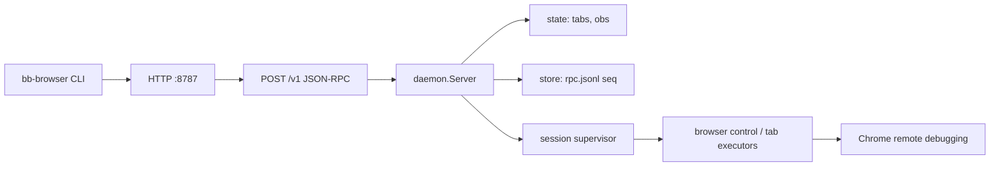

# go-bb-browser

用 **Go** 实现的 [bb-browser](https://github.com/epiral/bb-browser) 风格工具链：**CLI（`bb-browser`）→ 本地 HTTP 守护进程（`bb-daemon`）→ 仅通过 CDP 控制已启动的 Google Chrome**。守护进程**不会启动浏览器**，只通过 **chromedp** 附加到你用 `--remote-debugging-port`（等）拉起的 Chrome；**无扩展、不支持其他浏览器**。

面向 Agent 的约定见 [`AGENTS.md`](AGENTS.md)。

## 构建与测试

```bash
go build -o bb-daemon ./cmd/bb-daemon
go build -o bb-browser  ./cmd/bb-browser
go test ./...
```

## 快速开始

1. 启动带远程调试的 Chrome（可用 CLI 辅助）：

   ```bash
   ./bb-browser launch
   # 标准输出为 host:port，例如 127.0.0.1:9222 → 供 bb-daemon --debugger-url 使用
   ```

2. 启动守护进程（附加到上一步的调试端口）：

   ```bash
   export BB_BROWSER_DEBUGGER_URL=127.0.0.1:9222   # 或每次传 --debugger-url
   ./bb-daemon
   # 默认监听 127.0.0.1:8787；可用 --listen 或 BB_BROWSER_LISTEN
   ```

3. 用 `bb-browser` 调接口（默认 `--url http://127.0.0.1:8787`，可用 `BB_BROWSER_URL` 覆盖）。

---

## `bb-daemon` 架构

数据流：**客户端（CLI / 任意 HTTP） → `bb-daemon` HTTP → JSON-RPC 分发 → `internal/browser`（chromedp CDP 会话）→ Chrome**。

| 层级 | 职责 |
|------|------|
| **`cmd/bb-daemon`** | 解析 `--debugger-url` / `--listen`（及对应环境变量），构造 `daemon.Config`，启动 `daemon.Server`。 |
| **`internal/daemon`** | `http.ServeMux`、JSON-RPC 分发、tab 生命周期协调器和 CDP supervisor。supervisor 以 `Browser.getVersion` 维护 `ready → suspect → failed`；确认失败后 daemon 非零退出，由 systemd/Docker 重启，不在进程内重连。 |
| **`internal/store`** | **RPC log**（`{StateDir}/rpc.jsonl`，append-only）；**全局单调 `seq`**（启动时以纳秒时钟为起始值，内存自增）。 |
| **`internal/state`** | **tab 注册表**（`TabRegistry`：以完整 CDP target id 登记 page target，关 tab 后该 id 不再可解析、清缓冲）；**按 tab 隔离的观测环形缓冲**（`TabObsStore` + `ringbuf`），满足 INV-1～INV-7 类不变量。 |
| **`internal/daemon`（观测）** | network / console / errors 首次查询时按需启用并续租；listener 只向每 tab 的 1024 容量非阻塞队列投递，worker 编码并写 ring buffer。 |
| **`internal/browser`** | browser control 只在 browser executor 上执行 `Browser.*` / `Target.*`；每 tab 独立缓存执行 context，observer context 与页面操作 context 分离；**不**负责启动 Chrome。 |
| **`pkg/protocol`** | JSON-RPC 请求/响应与各 `method` 的 params/result 类型，供 daemon 与 `pkg/daemonclient` 共用。 |



**环境变量（节选）**

| 变量 | 含义 |
|------|------|
| `BB_BROWSER_DEBUGGER_URL` | Chrome DevTools 端点（`host:port` 或 ws/http URL），等价 `--debugger-url` |
| `BB_BROWSER_LISTEN` | daemon 监听地址，默认 `127.0.0.1:8787` |
| `BB_BROWSER_API_TOKEN` | daemon API token 白名单，英文逗号分隔，与可重复的 `--api-token` 合并；CLI 使用同名变量或 `--api-token` 发送单个 token（标志覆盖环境变量） |
| `BB_BROWSER_API_TOKEN_ALLOW_LOOPBACK` | 等价 `--api-token-allow-loopback`，默认 `false`；仅真实 TCP 回环对端且无代理头的 `POST /v1` 免 token；布尔值支持 `true/false`、`1/0`、`t/f` 及其 `strconv.ParseBool` 大小写形式，非法或空值回退 `false`，标志覆盖环境变量 |
| `BB_BROWSER_API_TOKEN_FILE` | daemon token 文件路径，等价 `--api-token-file`；一行一个 token，忽略空行和 `#` 注释行 |
| `BB_BROWSER_TAB_IDLE_TIMEOUT` | 自动关闭 daemon 创建的 idle tab 的超时，默认 `5m`；`0` 禁用 |
| `BB_BROWSER_CDP_WATCHDOG_INTERVAL` | `Browser.getVersion` 探测间隔，默认 `5s` |
| `BB_BROWSER_CDP_WATCHDOG_TIMEOUT` | 单次探测超时，默认 `2s` |
| `BB_BROWSER_CDP_WATCHDOG_FAILURES` | 连续失败多少次后确认 session 失效并退出，默认 `3` |
| `BB_BROWSER_OBSERVER_IDLE_TIMEOUT` | 观测接口无查询后 disable CDP domain 的时间，默认 `5m`；`0` 表示保持到 tab 关闭 |
| `BB_BROWSER_STATE_DIR` | RPC log 目录，默认 `~/.local/state/bb-daemon`（`rpc.jsonl`）；`-` 为 in-memory；等价 `--state-dir`。日志含请求体（可能有密码、令牌），因此目录为 `0700`、`rpc.jsonl` 及轮转备份为 `0600`；启动时会收紧既有目录、日志与 `.1`–`.3` 备份的更宽权限（不放宽更严格的权限，不动目录内其他文件），收紧失败则启动报错 |
| `BB_BROWSER_RPC_LOG_MAX_BYTES` | `rpc.jsonl` 超过该字节数即轮转，默认 `8388608`（8 MiB）；等价 `--rpc-log-max-bytes` |
| `BB_BROWSER_LOG_LEVEL` | slog 级别：`debug` / `info` / `warn` / `error`，默认 `info`；等价 `--log-level` |
| `BB_BROWSER_LOG_FORMAT` | slog 输出格式：`text` 或 `json`，默认 `text`；等价 `--log-format` |

**可选 API token**：daemon 将重复的 `--api-token`、`BB_BROWSER_API_TOKEN`（英文逗号分隔）和 `--api-token-file` / `BB_BROWSER_API_TOKEN_FILE` 的内容合并，去首尾空白、去重、忽略空项；文件忽略空行和以 `#` 开头的注释行。文件路径的标志覆盖环境变量；文件读取失败会拒绝启动。合并后为空时保持原有行为；未启用且监听非回环地址时只打一条 warn，不拒绝启动。修改白名单需重启 daemon。

启用 token 后，除下述显式开启的回环豁免外，`POST /v1` 必须携带 `Authorization: Bearer <token>`（客户端每次只传白名单中的一个 token），否则返回标准 **HTTP 401**，`Content-Type: text/plain; charset=utf-8`，正文固定为 `unauthorized\n`，并带 `WWW-Authenticate: Bearer`。鉴权在读取请求体、RPC 分发和 audit 前完成，失败请求不会操作浏览器或写 `rpc.jsonl`。`/live`、`/ready`、`/health` 始终免 token。API token 不写入启动日志、错误信息或 RPC audit；用 token 文件可避免 token 出现在 daemon 进程参数中。

```bash
# 文件一行一个 token；此处和部署示例只使用占位符
bb-daemon --debugger-url 127.0.0.1:9222 --api-token-file /path/to/api-tokens
BB_BROWSER_API_TOKEN='<caller-token>' bb-browser tab list
```

**可选回环免 token**：`--api-token-allow-loopback` / `BB_BROWSER_API_TOKEN_ALLOW_LOOPBACK` 默认关闭，修改后需重启。开启且白名单非空时，仅根据 `r.RemoteAddr` 的真实 TCP 对端判断回环（`127.0.0.0/8`、`::1`，含 IPv4 映射 IPv6）；无代理头才直接放行，**不校验 Authorization，即使带错误 token 也放行**。绝不使用 `Host` 或转发头判断本机。未配置 token 时开关无副作用，启动打一条 info；有 token 时启动打一条 warn，不逐请求记录。

请求只要出现 `X-Forwarded-For`、`X-Forwarded-Host`、`X-Forwarded-Proto`、`X-Real-IP`、`Forwarded`、`CF-Connecting-IP`、`CF-Ray`、`True-Client-IP`、`Via`、`X-Forwarded-Server`、`X-Forwarded-Port`、`X-Forwarded-Scheme`、`X-Original-Forwarded-For`、`Forwarded-For`、`X-Client-IP`、`X-Cluster-Client-IP` 或任意 `Tailscale-` 前缀头（头名大小写不敏感，即使值为空），就仍需有效 token。**头检测只是兜底，不是主要防线**；开启前必须确认部署路径。

- 本机直接调用可以开；Tailscale **HTTP 转发**（`serve` / `funnel` 默认模式，代理头完整保留到 daemon）可以开，转发请求会触发兜底，仍需 token。[Serve 官方文档](https://tailscale.com/docs/features/tailscale-serve#identity-headers) 确认用户身份头，且说明 tagged 设备及 Funnel 不带身份头；[官方 HTTP 代理源码](https://github.com/tailscale/tailscale/blob/main/ipn/ipnlocal/serve.go) 还设置 `X-Forwarded-Host`、`X-Forwarded-For`，TLS 时设置 `X-Forwarded-Proto`，Funnel 时设置 `Tailscale-Funnel-Request`。后者未能从官方文档确认，此处依据源码，未实测。
- **不要开**：Tailscale **TCP 转发**（如 `tailscale serve --tcp` / `--tls-terminated-tcp`）、同机反向代理且可能去头、Docker 端口映射、cloudflared 隧道，或不确定中间有没有代理时。

```bash
# 仅限确认部署路径后开启；本机直接调用可以省略 token
bb-daemon --debugger-url 127.0.0.1:9222 --api-token-file /path/to/api-tokens --api-token-allow-loopback
bb-browser tab list
```

**Tab id = 完整 CDP target id（破坏性变更）**：`tab_new` / `tab_list` / `tab_focus` 返回的 `tab`、`focus` 以及所有定向方法的 `tab` 参数，都是 Chrome 给出的**完整 CDP target id**（不透明字符串，如 `E3B0C44298FC1C149AFBF4C8996FB924`），daemon 原样使用、逐字节精确匹配：

- 旧版的 4 位起十六进制**短 id（后缀别名）已移除**，daemon 不再生成也不再解析；短 id、任意前缀/后缀/截断、大小写变体、首尾带空白的写法一律返回 `unknown tab id`（`-32602`）。只有空字符串算“缺少 tab”（`missing tab`，CLI 报 empty id）；其它任何值（包括纯空白）都按字节原样查找，不做 trim。
- 显式给出的 id 未知或已过期时**直接报错**，绝不回退到焦点 tab、其他 tab 或“看起来相近”的 tab。`unknown tab id` 只在 daemon 确实问到了浏览器（或登记表本身已有结论）而该 id 不存在时返回：解析一个尚未登记的 id 需要的那次 target 枚举若自己失败或超时，定向方法返回 `failed to list targets`（`-32000`，`data.hint` 带原因，超时会写明单次 RPC 的时限），**不会**把查询失败说成身份无效——同一个 id 在枚举恢复后照常可用，Pool 也不会把它当成 `UnknownTabError`。目标消失后，持有旧 id 的请求（包括正在等待该 tab 操作锁的请求）只会失败，不会落到之后出现的其他目标上。
- 一次请求解析出的 target id 贯穿该请求的操作锁、CDP 命令、idle 续期与 `rpc.jsonl` 审计记录，中途不重新解析。
- 迟到的浏览器回复/事件不会让已失效的 id 重新生效。daemon 为每个在途的浏览器请求（`Target.createTarget`、`Target.getTargets`）记录“请求发出之后”观察到的失效与缺席，回复应用时据此裁决，请求结束即丢弃，不保留任何删除历史：
  - `tab_new` 的创建回复到达前该 tab 若已被关闭/销毁/被某次枚举确认消失，`tab_new` 返回错误 `tab closed before tab_new completed`：不登记、不纳入 idle 受管、不选中，并对这个刚创建的 id 做一次有界（5s）关闭回滚，错误 `data.hint` 带该 id 与清理结果（`closed` / `already gone` / `not closed (...)`），重新调用即可。创建请求本身失败或超时时 daemon 拿不到 id，无法回滚；浏览器若仍建出了 tab，它只是一个未受管的普通 tab，会出现在 `tab_list`。
  - 较早发出的 target 枚举回复不会重新登记“请求期间已被删除”或“请求期间另一次已应用的枚举未列出”的 tab，也不会删除请求发出之后由 `tab_new` 提交或由生命周期事件登记的 tab（并发新建不受更早、哪怕为空的快照影响）；已登记的 tab 不会因为迟到的创建回复/事件被“续新”，之后发出的枚举若不再列出它，照常删除。
  - 仅凭另一次**交叠**枚举“发现”而登记的 tab 不享受上述保护：两份交叠快照先后不可知（可能是此快照之后才打开，也可能是此快照之前已销毁）。这既不是“存在”也不是“已消失”的证据，所以该 id 只是**暂停解析**（定向请求得到 `unknown tab id`），它的观测缓冲、idle、受管记录以及 daemon 与该页面的 CDP 附着**全部保留，不会因此关闭页面**；daemon 随即自行再发一次枚举（冲突之后发出，可与之前的证据排序）裁决：tab 仍在则恢复解析，已消失才真正删除（最迟约 1s；其间对该 id 的定向请求也会触发枚举）。两份矛盾快照无论以哪种顺序应用，都会触发这次重新枚举。只有浏览器确认目标已消失（关闭回复、销毁通知、可证明更新的枚举未列出）时 daemon 才释放附着。
  - `tab_new` 提交时若存在这类无法排序的缺席证据（创建期间有枚举未列出新 tab），daemon 在应答前再问一次浏览器；新 tab 已不在则返回上面的 `tab closed before tab_new completed`，不会把已消失的 tab 交给调用方。新 tab 即使已先被自己的创建通知登记，这一判定也完全相同（已登记不是跳过核验的理由）。这次核验自身失败（例如枚举出错）时不据此下结论：若该 tab 其间已被别的调用 `tab_close` 或被销毁通知判定消失，`tab_new` 同样报错；仍在登记中则成功返回，冲突留给同步循环重试。“其间是否被判定消失”按**从提交到核验结束这段时间里的失效记录**判断，而不是看核验结束时该 id 能否解析：`tab_close` 成功之后发出的枚举可能把仍在关闭中的同一个 target 重新发现为普通 tab，那并不是这次 `tab_new` 创建的受管 tab，`tab_new` 仍然报错并回滚。
  - daemon 的连接自行在 browser 级开启 target 生命周期通知（`Target.setDiscoverTargets`）：用户在浏览器里关闭 tab 后，无需任何 RPC，该 id 即失效，登记、idle 与受管记录随之清除。宿主不支持该命令时启动日志告警一次，退化为仅靠枚举发现消失。
  - 生命周期事件以**读出连接的时刻**为准，而不是排队后被处理的时刻：在某次枚举请求发出之前读到的“存在”事件，不能让目标躲过那次枚举确认的缺席——即便 `tab_new` 的创建回复在该事件被处理之前就登记了这个 tab：已登记目标保留**最早**的存在证据，较晚的创建提交不会顶替更早读到的事件，事件与那次枚举谁先被处理结果都一样（该 id 停止解析并清理）；这份存在证据在目标**尚未登记**时同样有效：读到某个未登记 tab 的 page 事件后，daemon 记下读出时刻，直到该 tab 被登记、被报告消失，或被一次在那之后发出的枚举回答为止（列出则登记，未列出即判定消失并记入所有在途请求），所以“事件已读、之后发出的列表确认缺席、列表先于创建回复被应用”时，迟到的创建回复不会登记这个 tab，`tab_new` 直接按上面的规则报错回滚，期间没有任何请求能解析到它；列表早于该 tab 创建发出时不构成证据，新 tab 照常提交并核验。排队期间若已应用过 `tab_close` 回复、一次枚举，或事件队列发生过溢出，该事件不再登记未登记的 tab，而是触发一次重新枚举（读出时刻的存在证据保留到那次枚举应用为止）。
  - 销毁通知在**读出连接的那一刻**即生效（不等排队处理，事件队列已满被丢弃时也一样）：该 id 立即停止解析，并记入所有在途请求，此后迟到的创建回复、仍列出它的枚举回复、以及在它之前读到但仍在排队的“存在”事件都不能登记这个 tab（该 tab 当时是否已登记都一样；这条记录只保留到该销毁通知被处理或被更新的缺席证据覆盖为止）；队列溢出要等这些都记录完毕才对同步循环可见，因此补偿枚举一定在其后发出。队列溢出期间创建又销毁的 tab，其 `tab_new` 仍按上面的规则报错回滚，不会留下已销毁的受管 tab。
  - `Target.closeTarget` 成功后浏览器若仍短暂列出该 target，关闭生效**之后才发出**的枚举、或之后才从连接读到的 page 事件（created / info changed）会再次登记它，直到销毁事件到达；关闭之前发出的回复、之前读到的事件不会。
- `tab_close` 收到浏览器明确的“目标不存在”时仍返回关闭失败，但同时清除该 id 的登记、观测缓冲、idle 与受管记录；其它关闭失败不改动任何状态。`tab_select` 与其它定向方法一样持有该 tab 的操作锁：idle 清理正在关闭同一 tab 时，选择会等待并得到 `unknown tab id`，不会成功或续期。
- 只有 `tab_list` / `tab_focus` 以及 CLI 省略 `--tab` 时才使用 daemon 焦点 tab；CLI 显式传空的 `--tab ""` 会报错而不是改用焦点 tab。
- **迁移**：旧客户端不要缓存或拼接短 id，改为保存并原样回传 `tab_new` / `tab_list` 返回的 `tab`；脚本里写死的 `--tab ab12` 之类需要换成 `bb-browser tab list` 输出的完整 id。Pool 调用方同理（`<backendKey>:<完整 id>`，见 [`pkg/daemonclient`](pkg/daemonclient/README.md)）。
- CDP target id 在同一个运行中的浏览器内唯一；本项目**不承诺**它跨浏览器重启/跨浏览器会话永久唯一，也不引入所有权或租约协议。

**Idle tab 自动清理**：`tab_new` 创建的 tab 会被 daemon 跟踪；在 `BB_BROWSER_TAB_IDLE_TIMEOUT` 内无操作则自动 `tab_close`。清理时若 Chrome 中的目标已不存在，直接清除该 tab 的本地状态，不告警或重复重试；其他关闭失败仍告警并保留重试。tab 相关 JSON-RPC 的 **`method` + 原始 request body** 写入 `rpc.jsonl`（audit 行，异步写入；请求实际解析到的完整 CDP target id 记在 `target` 字段，未解析成功的请求没有该字段）；idle 状态维护在内存。

**受管 tab 的持久化生命周期**：哪些 tab 属于 daemon（managed 集合）只由两种同步写入的生命周期记录决定，二者都携带**完整 CDP target id**：`tab_new` 成功时写 `managed_tab_open`；tab 被 `tab_close` 成功关闭、被 idle 清理关闭、收到 target 销毁事件，或在一次成功的 target 枚举中确认已消失时写 `managed_tab_retire`。audit 行（包括 `tab_new` / `tab_close`）不会增删 managed 集合，只会按 `target` 精确匹配刷新仍受管 tab 的最后活跃时间，因此延迟到达的 audit 行不会让已退役的 tab 复活，也不会影响其他 tab。关闭失败（非“目标已不存在”）或枚举失败不会退役仍存活的 tab。登记变更与受管记录在同一个临界区内完成（先登记表、后 idle/`rpc.jsonl`），所以不会出现“tab 已删除但其后又写入 `managed_tab_open`”的交错。枚举只会删除（并退役）**在发出该枚举请求之前**就已登记的 tab：请求在途期间由 `tab_new` 新建的 tab 不会因为没出现在这次（更早的）枚举结果里而被退役。上一个 daemon 进程留下、尚未恢复的受管成员由本进程第一次成功的枚举裁决（无论它来自启动、重新同步还是某个 RPC）：id 完全一致且存活的恢复 idle 跟踪，回复未列出的退役。

**daemon 重启**时先通过 CDP 获取当前存在的 tab，再回放 `rpc.jsonl`：只有**完整 target id 完全一致**且仍存活的 tab 才恢复 idle 跟踪并沿用其最后活跃时间；其他 tab（例如用户自己打开的 tab，即使 id 后缀相同）绝不会被当成受管 tab，也不会被 idle 清理关闭；记录中已不存在的 target 会被退役。重启后有约 30s grace。**旧版本兼容**：只写短 id（`tab` 字段，现已不再写入也不再读取）而没有 `target` 的旧版本记录无法证明身份，回放时保守跳过（启动时告警一次并给出此类 `tab_new` 记录数）；这些由旧版本创建且仍打开的 tab 将不再被自动 idle 关闭，需要时请手动 `tab_close`。生命周期记录写盘失败时内存状态仍会更新并打印 warn，不视为已持久化：未写入的 `managed_tab_open` 表示该 tab 重启后不再受管；未写入的 `managed_tab_retire` 表示陈旧条目会留在 `rpc.jsonl` 直到下次轮转或重启对账（恢复要求 target 精确一致，陈旧条目不会导致误关其他 tab）。

全局 `seq` 以启动时的纳秒时钟为起始值内存自增，无需持久化即可跨重启保持递增。`rpc.jsonl` 超过约 8 MiB 会自动轮转：旧文件保存为 `rpc.jsonl.1`…（保留 3 份），新文件开头会写入当前仍受管 tab 的快照（每个 tab 一条 `managed_tab_open`，含完整 target id 与最后活跃时间；已退役的 tab 不会写入），因此恢复只需读当前文件即可保持完整。轮转是一次原子切换：快照先完整写入同目录的私有临时文件 `rpc.jsonl.tmp`（`0600`）并 fsync，随后在挪动任何备份之前，先把当前日志硬链接到私有暂存名 `rpc.jsonl.keep` 并核对它确实是 daemon 正在写的那个文件（链接失败，例如磁盘已满，不会动任何备份）；再把原 `rpc.jsonl.1` 以硬链接方式多挂一个名字 `rpc.jsonl.2`（更旧的备份顺移），用 rename 把暂存名原子替换为新的 `rpc.jsonl.1`——整个过程中 `rpc.jsonl.1` 这个名字始终指向一份完整的上一代；最后再次确认 `rpc.jsonl` 仍是正在写的日志，用 rename 把临时文件发布为 `rpc.jsonl` 并 fsync 目录。任何一步失败或进程在中途停止，`rpc.jsonl` 都仍是切换前的完整日志或已完整的快照，daemon 继续向原日志追加；失败会作为错误返回给触发轮转的那次追加（该条记录本身已写入当前打开的日志，daemon 记 warn，告警只说明“记录已写入、日志维护失败”，不承诺该记录在重启后一定可恢复），之后每次追加都会重试，重试不会多挤掉备份。状态目录由**单个 daemon 进程独占**：不支持两个进程共用同一个状态目录，也没有跨进程锁。轮转开始时、建立暂存硬链接后以及发布前都会确认 `rpc.jsonl` 这个路径仍是普通文件且指向 daemon 正在写的日志；若该路径已被删除、换成了别的文件或符号链接，轮转即被拒绝，不会覆盖或接管外来文件，也不会让 `rpc.jsonl.1` 失去可恢复的一代（同样作为轮转错误返回并在之后的追加中重试），`rpc.jsonl.1` 等备份原样保留供重启恢复，daemon 继续向已打开的日志写入；路径删除后写入的记录随被删除的文件丢失，重启从 `rpc.jsonl.1` 恢复，把原文件放回该路径后轮转自动恢复。快照发布成功但随后的目录 fsync 失败时不算轮转失败：新日志已生效并继续使用，错误单独报告（已轮转、目录同步未确认），之后每次追加（即使远未达到轮转阈值，也不论该次追加自身的写入或下一次轮转是否成功）以及关闭时只重试目录 fsync，不重做轮转；欠下的目录同步错误不会被同一次追加的写入失败或轮转失败掩盖，而是一并报告；普通追加仍不 fsync。daemon 退出时若关闭日志仍报错（例如目录同步始终未确认），该错误会并入退出错误（原有的服务错误保留在前），进程以非零状态退出并记录 `daemon exited`。受管集合为空时发布空文件。启动时会删除未发布的 `rpc.jsonl.tmp` 与遗留的暂存链接 `rpc.jsonl.keep`；已存在的 `rpc.jsonl` 必须是普通文件：若它是符号链接（包括悬空链接、指向普通日志的链接）或目录，启动直接失败并要求人工处理，不会跟随链接创建目标文件，也不触碰链接目标与 `rpc.jsonl.1`；若 `rpc.jsonl` 不存在而 `rpc.jsonl.1` 存在（旧版本在轮转中途停止，或活动日志被删除），会把 `rpc.jsonl.1` 链接回 `rpc.jsonl` 再回放，而不是新建空日志，链接失败则启动失败；此时若 `rpc.jsonl.1` 存在但不是普通文件（符号链接，包括悬空链接，或目录）或无法检查，启动同样失败并要求人工处理，不会当作不存在；两者都确实不存在才按首次启动创建空日志（不会用更旧的 `rpc.jsonl.2`/`.3` 推测恢复）。断电边界：快照内容在发布前已落盘，普通追加不 fsync（与此前一致），因此断电可能丢失最近的追加记录，但不会留下轮转造成的半截日志。状态目录需支持硬链接，否则轮转报错、日志继续增长但不丢数据。轮转只在类 Unix 系统（发布产物为 linux/amd64，开发与测试在 macOS）上验证；Windows 不是受支持的运行平台：那里 rename 无法替换仍被打开的日志文件，预计每次轮转都会报错（旧日志保持可写、持续增长），未做原生验证。启动时的可写性检查使用独占创建的 `.write-test-*` 临时文件，不会覆盖或删除目录中已有的文件（包括名为 `.write-test` 的文件）。回放按物理换行逐行解析：中间损坏的行告警并跳过（保留在文件中），其后的合法记录照常恢复；末尾缺换行的完整记录正常回放，后续追加前先补换行；末尾不完整的记录被截断。写入失败或短写后，下一次写入同样先补换行，避免与残片粘连。

**Docker Compose 示例**（需挂载 volume 才能跨容器重建保留 state）：

```yaml
services:
  bb-daemon:
    image: your/bb-daemon:latest
    environment:
      BB_BROWSER_DEBUGGER_URL: "http://chrome:9222"
      BB_BROWSER_LISTEN: "0.0.0.0:8787"
      BB_BROWSER_API_TOKEN: "<caller-a-token>,<caller-b-token>"
      # Docker 端口映射下不要开启回环豁免
      BB_BROWSER_API_TOKEN_ALLOW_LOOPBACK: "false"
      BB_BROWSER_STATE_DIR: "/var/lib/bb-daemon"
      BB_BROWSER_TAB_IDLE_TIMEOUT: "5m"
      BB_BROWSER_OBSERVER_IDLE_TIMEOUT: "5m"
      BB_BROWSER_CDP_WATCHDOG_INTERVAL: "5s"
      BB_BROWSER_CDP_WATCHDOG_TIMEOUT: "2s"
      BB_BROWSER_CDP_WATCHDOG_FAILURES: "3"
    ports:
      - "8787:8787"
    volumes:
      - bb-state:/var/lib/bb-daemon

volumes:
  bb-state:
```

镜像内默认用户为 `nonroot`（uid/gid 65532），并预置了归该用户所有的 `/var/lib/bb-daemon`。**全新的空 named volume** 首次挂载到该路径时由 Docker 复制镜像目录的属主，无需额外设置。以下情况不会自动处理，属主不对时 daemon 会以 `state dir … is not writable` 退出：

- **已有卷**：Docker 不会改动已存在的卷；例如用旧镜像（未预置该目录）创建的卷通常是 root 属主，可能需要校正（属主本来正确的卷不受影响）；
- **bind mount**：属主取决于宿主机目录；
- **`volume.nocopy: true`**，或挂载到 `/var/lib/bb-daemon` 以外、镜像内不存在的路径。

需要校正时请原地改属主而不是删卷（需要时先备份）。Compose 创建的卷名带项目前缀（如 `<project>_bb-state`），先用 `docker volume ls` 或 `docker volume inspect` 确认实际卷名，再执行 `docker run --rm -v <实际卷名>:/state busybox chown -R 65532:65532 /state`；直接写 `bb-state` 只会新建并修改一个无关的卷，修不到 compose 实际使用的卷。bind mount 在宿主机执行 `chown -R 65532:65532 <目录>`。镜像不以 root 启动，也不在运行时 chown。

**HTTP API 摘要**：`GET /live` 是纯 HTTP liveness，不访问 CDP；`GET /ready` 读取 supervisor 缓存，`suspect` / `failed` 返回 503；兼容的 `GET /health` 在 `ready` / `suspect` 返回 connected/200，仅 confirmed failed 返回 disconnected/503。进程存活探针使用 `/live`，接流量前使用 `/ready`。`POST /v1` 体为 JSON-RPC：`jsonrpc`、`method`、`params`、`id`。成功时 `result`；失败时 `error`（`code`、`message`、可选 `data`）。业务成功响应在适用处带 **`tab`** 与 **`seq`**；网络/控制台/错误等观测类结果带 **`cursor`** / **`events`** 等。非 POST 访问 `/v1` 返回 **405**。

Daemon 已实现但 **CLI 未封装** 的 JSON-RPC 方法：`tab_focus`（返回当前可操作 tab 元数据）。

**`POST /v1` 支持的 `method`（与 `pkg/protocol` 常量一致）**

| `method` | 说明 |
|----------|------|
| `tab_list` | 一次 `Target.getTargets` 列出 page target；`focus` 为 daemon 缓存，不 attach / eval tab |
| `tab_focus` | 并发探测 visibility 后返回当前可操作 tab 元数据；探测不完整时保留缓存焦点 |
| `tab_select` | 切换 daemon 焦点 tab |
| `tab_new` | 新建 tab（可选 `url`；`silent: true` 后台开 tab，不抢焦点） |
| `tab_close` | 关闭 tab |
| `goto` | 导航 |
| `reload` | 刷新 |
| `screenshot` | 截图（`png` / `jpeg`） |
| `eval` | 执行脚本 |
| `click` / `fill` | 点击 / 填表（`selector` 或 `ref`） |
| `snapshot` | 可交互树与 `@ref` |
| `fetch` | 页内 HTTP |
| `network` / `network_clear` | 网络观测读 / 清缓冲 |
| `network_route` / `network_unroute` | Fetch 域拦截 |
| `console` / `console_clear` | 控制台观测 |
| `errors` / `errors_clear` | 页面错误观测 |

---

## `bb-browser` CLI 命令一览

**根命令全局选项**

| 选项 | 环境变量 | 说明 |
|------|----------|------|
| `--url` | `BB_BROWSER_URL` | `bb-daemon` 根 URL，默认 `http://127.0.0.1:8787`（无尾部 `/`） |
| `--api-token` | `BB_BROWSER_API_TOKEN` | 一个 daemon API token，自动为 `POST /v1` 添加 `Authorization: Bearer <token>`；标志覆盖环境变量 |
| `--json` | — | 打印原始 JSON-RPC（部分子命令为完整 envelope） |
| `--tab` | — | tab id（完整 CDP target id，原样传给 daemon）；省略则用 `tab_list` 返回的 daemon 焦点 tab；显式传空报错 |
| `-v` / `--version` | — | 打印版本并退出 |

**超时预算**：daemon 对每个 JSON-RPC（`eval`、`fetch`、`snapshot`、`screenshot`、`goto` 等）的 CDP 工作上限是 60 秒；CLI 的每条命令（含 `run`，其中选 tab、开 tab 与 `eval` 累计计时）使用同一个 60 秒预算，不会比 daemon 等得更久。两者来自同一常量 `internal/timeout.Operation`，超时错误会写明该上限；更长的任务请拆成多条命令。

---

### `health`

- **作用**：`GET {--url}/health`。返回 supervisor 缓存的 Chrome CDP 状态，不同步探测和枚举 targets。
- **响应**：`{"status":"ok","browser":"connected"|"disconnected"|"skipped"}`。`browser` 为 `disconnected` 时 HTTP **503**。
- **参数**：无。

部署探针直接使用 HTTP：liveness 为 `GET /live`（`{"status":"ok"}`）；readiness 为 `GET /ready`（与 health 相同结构，`suspect` 即 503）。

---

### `launch`

- **作用**：在本机启动 Google Chrome（`--remote-debugging-port` + 持久 profile），标准输出打印 **`host:port`**，供 `bb-daemon --debugger-url` 使用。
- **参数**：无子命令参数。

| 选项 | 环境变量 | 说明 |
|------|----------|------|
| `--chrome` | `BB_BROWSER_CHROME` | Chrome 可执行文件路径；空则自动探测 |
| `-p` / `--profile` | `BB_BROWSER_PROFILE` | `--user-data-dir`；空则用各 OS 默认目录 |
| `--port` | — | 调试端口，默认 `9222` |
| `--bind` | — | `--remote-debugging-address`，默认 `127.0.0.1` |
| `--headless` | — | `--headless=new` |
| `--detach` | — | 默认 `true`：Chrome 后台跑，命令立即返回 |
| `--extra-arg` | — | 传给 Chrome 的额外参数（可重复） |
| `--start-url` | — | 启动时打开的 URL，默认 `about:blank` |
| `--wait-ready` | — | 默认 `true`：等待 CDP 端口可连 |
| `--wait-timeout` | — | `--wait-ready` 超时，默认 `15s` |

---

### `open URL`

- **作用**：新 tab 打开 URL（`tab_new`）；`--current` 时在焦点 tab 上 `goto`。
- **URL**：`open`、`open --current` 和 `tab new` 会先去掉输入首尾空白，再为无 scheme 的网址自动补 `https://`，包括 `localhost:8080`、`127.0.0.1:9222` 和 `[::1]:8080`；已有 scheme（如 `http://`、`about:blank`、`file:`、`chrome:`、`data:`）保持原样。去掉首尾空白后为空串、内部含空白或控制字符、无 host 的 HTTP(S) URL 等非法输入会在发送 RPC 前报错并以非 0 退出。
- **选项**：`--current`、`--wait N`（新开 tab 后睡眠秒数，便于慢页面）。

---

### `tab`

| 子命令 | 作用 | 备注 |
|--------|------|------|
| `tab list` | `tab_list` | |
| `tab new [url]` | `tab_new`；省略 url 为 `about:blank` | |
| `tab select` | `tab_select` | 必须 `--id <完整 tab id>` **或** `--index <1-based>`（按 tab id 排序） |
| `tab close` | `tab_close` | `--id` / `--index`；都不给则用 `--tab` 或焦点 tab |

---

### `snapshot`

- **作用**：页面树快照 JSON-RPC（含 `@ref` → 选择器映射）。
- **选项**：`-i` / `--interactive`、`-c` / `--compact`、`-d` / `--depth`、`-s` / `--scope`（CSS 根范围）。
- **ref 生命周期**：每次 `snapshot` 使此前所有 `@ref` 失效（旧 ref 报错而不是指向别的元素）；编号为纯数字，同一文档内递增不复用，导航 / 刷新后从 `@1` 重新开始。

---

### `eval SCRIPT…`

- **作用**：`eval`，脚本为剩余所有参数拼接。

---

### `click SELECTOR_OR_@REF`

- **作用**：`click`；`@N` 形式走 `ref`，否则走 CSS `selector`。

---

### `fill SELECTOR_OR_@REF TEXT…`

- **作用**：`fill`；首参为选择器或 `@ref`，其余为文本。

---

### `fetch URL`

- **作用**：页内 `fetch`（`fetch` JSON-RPC，带 cookie 等页面身份）。
- **选项**：`--method`、`--headers`（JSON 对象字符串）、`--body`、`--output`（写响应体到文件）。

---

### `screenshot [path.png]`

- **作用**：`screenshot`；默认解码 base64 写文件（路径参数或 `--output`，否则自动生成文件名）。
- **选项**：`--format`（`png` / `jpeg`）。

---

### `html`

- **作用**：通过 `eval` 取 `document.documentElement.outerHTML`；可选只保留“可见”子树（`--visible-only`，见命令 `--help` 长说明）。
- **选项**：`-o` / `--output`、`--format`（`html` / `markdown`）、`--visible-only`。

---

### `reload`

- **作用**：`reload` 当前/焦点 tab。

---

### `refresh`

- **作用**：`reload` 的隐藏别名。

---

### `close`

- **作用**：关闭 `--tab` 或焦点 tab（`tab_close`）。

---

### `goto URL`

- **作用**：对当前 tab `goto`。

---

### `console [filter]`

- **作用**：读控制台缓冲（`console`）；`--clear` 时调用 `console_clear`。
- **选项**：`--since`、`--filter`、`--grep`、`--with-body`。

---

### `errors [filter]`

- **作用**：读 JS 错误类缓冲（`errors`）；`--clear` → `errors_clear`。
- **选项**：同 `console`。

---

### `network`

| 子命令 | 作用 |
|--------|------|
| `network requests [FILTER]` | `network`；可选 URL 子串过滤；`--since`、`--with-body` |
| `network clear` | `network_clear` |
| `network route URL_PATTERN` | `network_route`（CDP Fetch 拦截）；`--abort`、`--body`、`--content-type`、`--status` |
| `network unroute [URL_PATTERN]` | `network_unroute`；省略 pattern 则清除全部规则 |

---

### `run SCRIPT.js [args…]`

- **作用**：读取适配器 JS 文件，组装参数后 `eval` 在页面执行（见 `internal/site`、`skills/bb-browser/references/script-system.md`）。
- **首参**：磁盘上的 `.js` 路径（第一个位置参数）；其余为传给脚本的参数。
- **位置参数**：按出现次序映射到 `@meta.args` 的键，并总是写入 `arg1`、`arg2`…
- **命名参数**：`--name value` 或 `--name=value` → `args.name`，值原样作为字符串传入。
- **输出与退出码**：适配器返回值以缩进 JSON 打印到 stdout，退出码 `0`。适配器返回 `error` 为非空字符串的对象（如 `{ error: 'HTTP 401', hint: 'please log in' }`）时视为失败：stderr 打印 `[error] …`（及可选的 `Hint:` 和登录提示），stdout 不输出结果，退出码非 `0`，不打印 usage。`--json` 下 stdout 仍输出完整 JSON-RPC 包络，stderr 与退出码同上——JSON-RPC 成功不代表适配器成功。空字符串或非字符串的 `error` 按普通返回值处理。

```bash
bb-browser run ./x.js hello --count 20        # args = { query: "hello", arg1: "hello", count: "20" }
bb-browser run ./x.js hello --count=20 --json # 同上，并输出原始 JSON-RPC
bb-browser run ./x.js --tab "$TAB" -- hello --tab x   # 全局 tab=$TAB（完整 tab id）；脚本得到 args.tab = "x"
```

参数规则（`run` 自行解析参数，不交给 Cobra，因此未知的 `--name` 不会被拒绝）：

| 写法 | 结果 |
|------|------|
| `--url` / `--api-token` / `--json` / `--tab` / `--help`（`-h`） | 保留名，始终是全局选项；可写在 `run` 之前、之后或与脚本参数穿插，支持 `--json=false`、`--tab=ID` |
| `--`（第一个） | 分隔符：其后的 `--name` 全部归脚本，包括上述保留名；本身不传给脚本 |
| `--name=`、`--name ""` | 空字符串 |
| `--name=a=b` | 只在第一个 `=` 处切分，值为 `a=b` |
| 同名多次 | 保留最后一次的值 |
| `-5`、`--offset -3` | 单横线开头的 token 是普通值（位置参数或命名参数的值） |
| `--name` 后无值，或下一个 token 以 `--` 开头 | 报错 `flag --name needs a value`；值以 `--` 开头时请写 `--name=--x` |

不支持无值布尔开关和以 `--` 开头的位置参数。缺少脚本路径、命名参数缺值、全局选项取值非法（如 `--json=maybe`）都会在向 daemon 发请求之前报错。

---

## 示例

```bash
./bb-browser launch --port 9222
./bb-daemon --debugger-url 127.0.0.1:9222

./bb-browser health
./bb-browser open https://example.com
./bb-browser snapshot -c
./bb-browser click '@1'
./bb-browser tab list --json
```

IPv6 本机调试地址可使用 `::1:9222`（daemon 会规范化为 `[::1]:9222`）。

---

## 相关包

- [`pkg/daemonclient`](pkg/daemonclient/README.md)：Go 语言 JSON-RPC 客户端。`NewClient` 连一台 daemon；`NewPool` 在多台 daemon 间均摊请求（每端独立 URL / 头），并把 tab 钉在创建它的那一台（tab 不能跨 daemon）。Pool 对外 tab id 为 `<backendKey>:<完整 CDP target id>`（默认 key 为构造时的 0-based 下标）；`TabList` 合并所有后端并带此外前缀。
